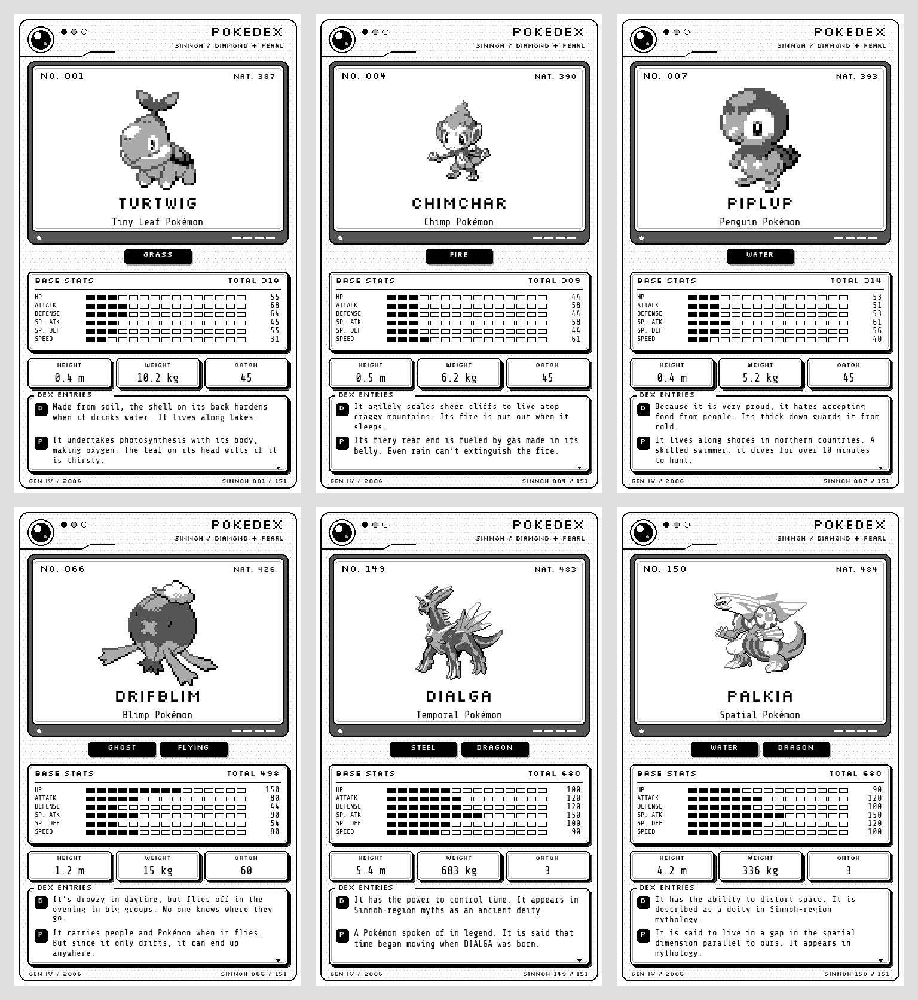
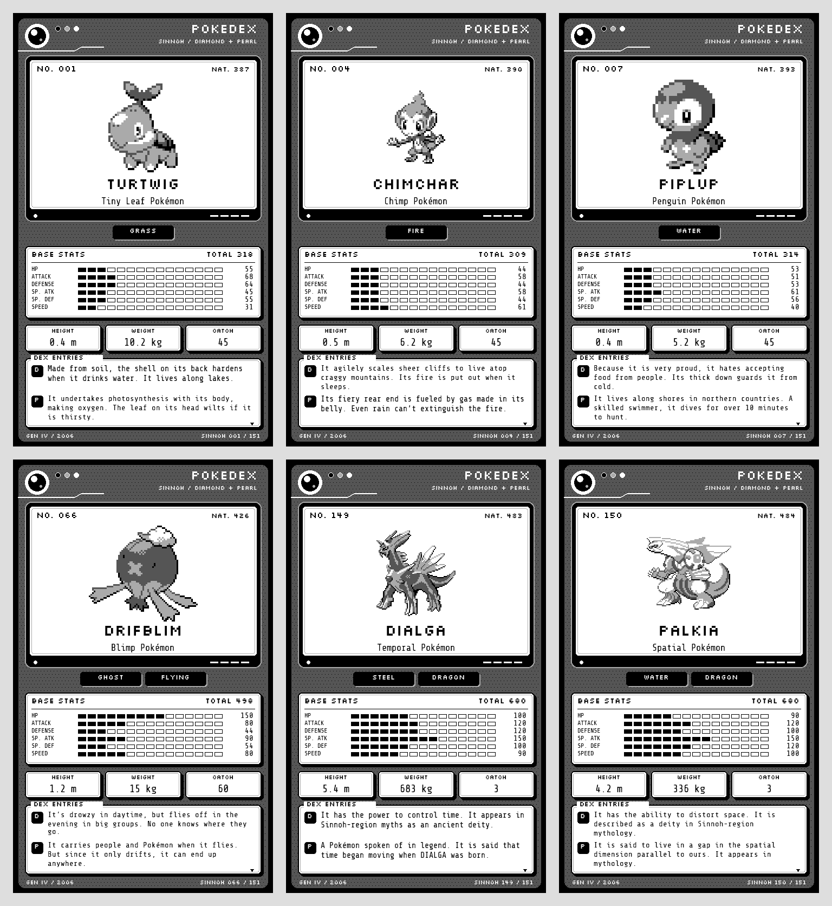

# Diamond / Pearl — Sinnoh Pokédex

151 e-ink plates in **original Diamond/Pearl Sinnoh order**, from Turtwig to
Manaphy. This is the original regional roster, rather than Platinum's expanded
210-entry roster or the 493-entry National Pokédex.



Each plate includes the original Diamond/Pearl pixel sprite, both regional and
National numbers, category, Gen IV typing and base stats, height, weight, catch
rate, and separate English Diamond and Pearl descriptions. The sprite is scaled
by an integer with nearest-neighbor sampling. No smoothing or dithering is applied
to the sprite pixels. The white background and simple rules keep the plate clear
on small monochrome displays. The retro Pokédex shell echoes the original Kanto
set with a lens and status lamps, a recessed sprite screen, rounded double-line
windows, offset shadows, and a Game Boy-style dialogue frame.

## Ready-to-use files

Choose a device, then a shell theme. Both themes keep the sprite and data windows
white. Both shells have a subtle two-shade plastic texture. **Dark** uses a
darker shell with a fully black surround outside the rounded Pokédex outline.
Both use rounded frames and offset shadows.

| Device | Native size | Light shell | Dark shell | Format |
| --- | --- | --- | --- | --- |
| X4 | 480 × 800 | [x4/light](x4/light) | [x4/dark](x4/dark) | Native four-grey, 4-bit BMP |
| X3 | 528 × 792 | [x3/light](x3/light) | [x3/dark](x3/dark) | Native four-grey, 4-bit BMP |



Filenames begin with the **Sinnoh** number: `x4/dark/001-turtwig.bmp` is
National #387. Copy the 151 BMP files from one device/theme folder to the reader's
`/sleep/` folder. The X4 BMPs also work for the upright reTerminal Sticky's BMP
reader firmware. Installation follows the device instructions in the
[main README](../../README.md#installing-on-the-device).
These exports have been checked in software; physical device appearance is not
yet verified. Only X3 and X4 sets are exported.

## Rebuild offline

From the repository root, with Python 3.10+ and Pillow installed:

```sh
python3 -m pip install -r 'Pokédex/diamond-pearl/requirements.txt'
python3 'Pokédex/diamond-pearl/render.py'
python3 'Pokédex/diamond-pearl/verify.py'
```

The renderer writes `diamond-pearl/{x3,x4}/{light,dark}/*.bmp`. To render only
selected devices, themes, or regional entries:

```sh
python3 'Pokédex/diamond-pearl/render.py' --devices x4 x3 --themes light dark --numbers 1 4 7
```

`data.json`, the source sprites, and both fonts are stored locally, so rendering
needs no network and uses no system fonts. To refresh source data (requires curl
and internet access), run `python3 'Pokédex/diamond-pearl/fetch.py'`.
The fetcher uses `past_types` and `past_stats` to restore Gen IV values where
PokéAPI records a subsequent change. Hidden abilities and modern experience yields
are omitted. Only the default form and default front sprite are used.

## Sources and attribution

- Data: [PokéAPI v2](https://pokeapi.co/docs/v2),
  [`original-sinnoh`](https://pokeapi.co/api/v2/pokedex/original-sinnoh/).
- Sprites: [PokéAPI's Diamond/Pearl sprite archive](https://github.com/PokeAPI/sprites/tree/master/sprites/pokemon/versions/generation-iv/diamond-pearl).
  These are the original **colour** 80 × 80 game sprites, converted to greyscale
  for these plates; they are not a separately drawn black-and-white sprite set.
  `data.json` records the exact sprite URL for each entry.
- [Silkscreen](https://github.com/google/fonts/tree/main/ofl/silkscreen) by Jason
  Kottke and [Share Tech Mono](https://github.com/google/fonts/tree/main/ofl/sharetechmono)
  by Carrois Type Design, both SIL Open Font License 1.1. Fonts and license texts
  are bundled in `assets/fonts`.

Pokémon, character names, game sprites, and game descriptions remain the property
of their respective rights holders, including Nintendo, Game Freak, and Creatures.
This is an unofficial, non-commercial fan project. The fonts' OFL does not apply
to the Pokémon artwork or text.
